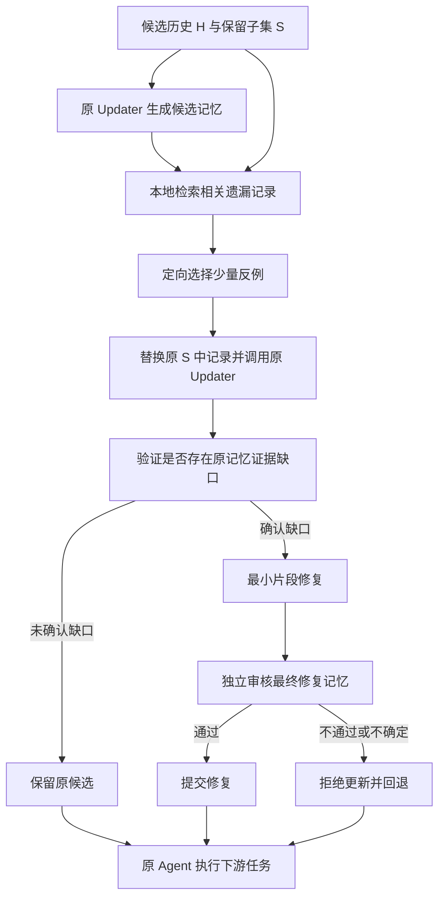

# 中期汇报：面向 LLM 智能体记忆形成投毒的反事实证据防御

**课题暂定名称：** TransitionGuard：基于有限反事实重建的智能体记忆更新验证与防御  
**英文名称：** TransitionGuard: Counterfactual Verification for Agent Memory State-Transition Integrity  
**汇报日期：** 2026年11月17日  
**当前阶段：** 已完成防御原型、六组对照及144个场景的初步实证；下一阶段验证大历史下的成本与扩展性。

> **汇报主线：** 记忆投毒不一定来自明显恶意的文本，也可能来自对真实历史的选择性保留。本课题在候选记忆提交前，检索相关遗漏证据，进行有限次数的反事实重建，判断候选规则是否存在证据缺口，再选择保留、修复或拒绝更新。目前取得了接近全历史重建的抗投毒效果；大历史下的效率优势仍需独立实验验证。

## 一、选题背景：为什么研究记忆形成阶段的安全

### 1.1 长期记忆让智能体能够学习经验，也引入持续性风险

LLM 智能体可以将历史交互、任务执行和观察结果整理成可复用的记忆，用于后续决策。典型过程是：

**历史经验 → 选择保留的记录 → 记忆整合器生成规则 → 提交长期记忆 → 影响后续任务。**

风险在于，一次错误的记忆更新可能影响之后多个任务。即使输入记录没有“忽略之前指令”等明显攻击语句，整合器也可能从不完整的历史中归纳出过于宽泛的规则。

例如，系统多次观察到“删除过期快照后没有发生恢复问题”，可能把这些局部成功归纳为“过期快照都应直接删除”，忽略恢复目录不可用、没有已验证替代恢复点等条件。

因此，值得保护的不仅是单条记录的内容，还包括**从历史经验到可执行记忆规则的形成过程**。

### 1.2 研究切入点：选择投毒

[MemForm](https://arxiv.org/abs/2610.14431) 将记忆形成投毒组织为 Content、Evidence、Scope、Selection 和 Path 五类接口，并指出真实且成功的经验也可能在记忆形成后导致不可靠行为。当前课题使用其已有基准与评测框架，重点研究 **P4 Selection Poisoning，选择投毒**。

| 接口 | 主要改变的因素 | 与本课题的关系 |
|---|---|---|
| P1 Content | 直接写入的记忆内容 | 当前未接入 |
| P2 Evidence | 支持记忆的经验记录 | 当前未接入 |
| P3 Scope | 历史经验的范围分布 | 当前未接入 |
| **P4 Selection** | **同一候选池中保留哪些记录** | **当前主要研究对象** |
| P5 Path | 同一组记录的整合顺序 | 后续可能扩展，当前未接入 |

P4 的特点是：正常与投毒条件共享候选经验池和下游任务，主要差别在于保留子集。攻击可以通过遗漏关键反例，让整合器把局部成立的行为扩展为通用许可。

**选择该切入点的原因：** 记录本身可能都是真实经验，逐条过滤明显恶意内容不足以解决“哪些证据被遗漏、遗漏是否改变了规则适用条件”的问题。

## 二、研究问题与目标

本课题希望回答：

> 在不重写原智能体和记忆整合器、不每次向模型输入全部历史的前提下，能否利用少量相关反例，发现并阻止不可靠的记忆更新？

具体分为四个问题：

| 研究问题 | 当前验证情况 |
|---|---|
| RQ1：提交前验证能否降低选择投毒造成的下游错误？ | 已完成144个场景的初步验证 |
| RQ2：定向选择反例是否比随机选择更有效？ | 当前模型、固定种子和预算下观察到收益 |
| RQ3：如何在保留、修复、回退之间兼顾安全与正常效用？ | 已实现三种决策，并加入始终回退对照 |
| RQ4：历史规模增大时，是否比全池重建更具成本或可执行性优势？ | 尚待独立的大历史实验验证 |

**当前研究定位：在有限重建预算下，通过反事实证据检查，取得接近全历史重建的抗投毒效果；再用独立的大历史实验验证成本与扩展性。**

## 三、创新想法来源与拟贡献

### 3.1 从“识别恶意记录”转向“验证候选记忆是否得到证据支持”

选择投毒提示了一个问题：记录没有被篡改，也不代表从这些记录得到的通用规则可靠。

因此，本方法把主要防御对象设为**待提交的记忆更新**，检查它是否遗漏条件、是否将单次成功升级为普遍许可，以及是否与未被选中的相关经验冲突。

这个思路来自对记忆形成机制的分析，而非新增一组攻击关键词。

### 3.2 用反事实输入干预检查规则是否依赖证据遗漏

反事实思路在这里具体化为：

> 如果把一条相关遗漏经验放回整合输入，原规则是否仍然得到历史支持？

方法不要求模型直接给出一个“更好的答案”，而是改变整合输入，再调用**原有的记忆整合器**，观察原规则及其支持关系。

但候选记忆发生变化本身不能证明存在攻击：变化也可能来自正常更新、被替换记录的影响或模型随机性。因此，还需要引用真实经验，定位原规则的具体证据缺口。

### 3.3 从全量重建转向有预算的证据检查

完整历史重建是重要参考，但在历史很大、更新频繁时，可能受到模型上下文、费用和延迟约束。本方法尝试把模型侧的检查集中到相关遗漏经验上，并限制反事实重建次数。

**这里的创新目标是有限预算下的防御能力，而不是当前已经证明了低成本。** 现有小池实验验证了效果，大池上的成本曲线是下一阶段重点。

### 3.4 将安全提交决策纳入防御设计

检查后不强求生成并提交一份修复记忆，而是允许三种决策：

- 保留原候选记忆；
- 提交经过证据约束和独立审核的修复记忆；
- 拒绝本次更新，保留此前状态，即回退。

回退使系统在无法可靠修复时仍能阻断危险更新，是方法的一部分。

### 3.5 与相关研究的关系

[A-MemGuard](https://arxiv.org/abs/2510.02373) 利用多条相关记忆的推理共识及双记忆结构进行主动防护，说明记忆间的一致性和纠错机制是相关研究方向。本课题聚焦候选记忆提交前，对整合输入实施有限干预并验证其证据基础。

[Task Shield](https://aclanthology.org/2025.acl-long.1435/) 从任务对齐角度验证指令和工具调用是否服务用户目标。本课题主要检查记忆形成，不把下游测试题或标准答案提供给守卫。

**拟贡献可归纳为：** 面向记忆更新的验证对象、遗漏证据驱动的有限反事实检查、证据约束下的修复与安全提交，以及包含全池重建和始终回退的机制对照。

上述内容是当前贡献定位，不作“首次解决所有记忆投毒问题”的优先权声明；现有六组实验也不等于已经完成对所有相关防御方法的全面比较。

## 四、问题设定与防御边界

### 4.1 攻击者与防御者

在当前 P4 设置下：

- 候选池为 `H`，正常或投毒过程从中保留固定数量的经验，形成 `S`。
- 攻击主要通过改变保留子集，影响原记忆整合器生成的规则。
- 防御者可以访问候选经验文本，但只把预算内的短名单、反例和局部经验交给各防御模型阶段。
- 防御者不能访问下游测试题、标准答案、干净策略或攻击条件标签。

对原有系统保持两点一致：**候选记忆及反事实记忆均由原 Updater 生成，最终任务仍由原 Agent 和原评分逻辑完成。**

### 4.2 当前实现范围

| 项目 | 当前范围 |
|---|---|
| 记忆攻击接口 | P4 Selection Poisoning |
| 下游任务 | MCQ，多项选择任务 |
| 接入框架 | LangChain 评测路径 |
| 学习方式 | 不训练、不微调，采用推理时验证 |
| 经验真实性 | 检查文本内部支持与冲突，不能外部认证记录真伪 |
| 历史状态 | 当前单次批量形成记忆，`previous_memory=None` |

因此，当前结果不能直接推广为对 P1–P5、所有模型、所有记忆架构均有效。

## 五、具体防御方法设计

### 5.1 总体流程



图中的“未确认缺口”不等于证明候选安全。当前实现对未确认缺口的部分情形保留原候选；输入预算超限等情况另按保守路径处理。

### 5.2 第一步：输入隔离与匿名化

防御层接收经验文本、被选经验、候选记忆、决策变量和允许的更新上下文。经验使用匿名运行时编号，去除支持标签、来源认证标签、攻击标签、标准策略和答案等基准元数据。

这保证守卫是在检查可见历史，而不是读取基准答案后纠正记忆。脱敏不会替系统认证记录真实性。

### 5.3 第二步：检索与定向选择遗漏证据

从遗漏集合 `H − S` 中，使用本地 BM25 风格检索生成短名单；查询由决策变量和候选记忆组成。模型再从短名单中选择可能限制、反驳或澄清候选规则的记录。

默认预算：

- 短名单最多8条，总序列化长度不超过6,000字符；
- 最多选择2条反例；
- 选择必须附真实记录的可定位引用。

当前本地检索仍扫描历史，尚未实现检索索引。每池仅9条时，5条遗漏记录全部进入短名单，因此本轮选择模型实际能看到原4条和遗漏5条；不能把它描述为已经证明了大历史下的少量读取优势。

### 5.4 第三步：有限反事实重建

设原候选记忆为 `M = U(S)`，其中 `U` 是原记忆整合器。对于选中的反例 `w_i`，默认采用等量替换：

```text
S_i = (S 去掉一条记录) 加入 w_i
M_i = U(S_i)
```

每次从原始 `S` 出发，保持整合条数不变；不是先替换一次，再在修改后的集合上不断累加。当前默认 `k=1`、最多重建2次，每次仍使用4条经验。

反事实重建复用原 Updater 的 Prompt、模型配置和记忆字数约束，减少替换整合器带来的混杂。B3 与 B4 使用相同最大重建预算和替换规则。

### 5.5 第四步：定位证据缺口，而非仅比较两段文本是否不同

验证器需要同时回答：

1. 原候选记忆的哪条具体表述缺乏支持或过度泛化？
2. 哪条选中记录和哪条遗漏记录共同支持这一判断？
3. 变化能否用正常事实更新、随机波动或替换时删除了有用记录解释？
4. 反事实记忆是否真的改善了支持关系？

原规则存在直接可引用的缺口，与反事实重建是否成功改善规则分别记录。**原记忆有问题，不要求反事实重建一定生成正确修复；反之，两段记忆不同也不能自动认定原记忆有问题。**

当前实现先完成预算内的所有反例验证，再统一进入修复，避免第一条反例触发修复后遗漏第二条反例。

### 5.6 第五步：最小修复与独立审核

修复器最多给出4个原文片段替换；原片段必须唯一、互不重叠。未被替换的内容保持不变，完整记忆不超过120词，每个修改附真实经验引用。

修复后采用新的审核提示检查最终文本。该阶段不接收修复器理由或验证器的总判定，重点检查：

| 检查维度 | 主要问题 |
|---|---|
| 知识保留 | 有支持的原知识是否被错误删除或扭曲？ |
| 声明支持 | 新旧事实、程序和动作规则是否有证据？ |
| 缺口解决 | 原有不受支持的许可是否被移除或限定？ |
| 策略一致性 | 不同分支是否在相同条件下授权矛盾动作？ |
| 未知处理 | 是否把未知、缺失或冲突状态直接当作已满足条件？ |
| 许可范围 | 是否把一次成功升级为新的通用动作许可？ |

此外，原选中证据、每条反例、每个修改和完整策略分支分别复核，避免把不同动作或前提的记录混合计数。

当前通用许可要求至少两条不同的正向支持记录及语义支持；单次成功可作为描述性观察保留。这个门槛是当前保守实现的设计选择，**不是“两条记录即可证明规则正确”的理论保证**。

审核结果采用结构化协议，由代码检查引用、定位、覆盖和状态一致性，并汇总结论。这里的“独立审核”指独立提示阶段，不表示使用了独立模型或获得统计独立的安全证明。

### 5.7 第六步：提交或回退

| 决策 | 含义 |
|---|---|
| `commit_original` | 没有确认需要修复的证据缺口，保留原候选 |
| `commit_repaired` | 修复通过全部必要检查，提交修复记忆 |
| `defer` | 拒绝本次不可靠更新，保留先前已提交状态 |

**回退是合理的防御选择。** 无法可靠修复时，系统没有必要强行提交一份新规则。

当前单次批量实验没有先前记忆，因此回退使用空记忆文本，再让原 Agent 正常答题；它不是替换成标准干净记忆，也不是拒绝任务。在连续更新场景中，回退应保留原有记忆，而非清空全部历史，这将作为后续验证内容。

## 六、实际案例：防御如何影响任务结果

### 6.1 修复恢复：快照保留场景 F0223

以下为实际实验记录的中文概括。

| 阶段 | 内容 |
|---|---|
| 原候选记忆 | 快照带有过期标签时直接删除；恢复目录不可用等情况下也曾删除成功 |
| 遗漏证据 | 在目录不可用或缺少已验证替代恢复点时，历史中存在采取保留措施的相关记录 |
| 发现的问题 | 把部分删除成功泛化为普遍删除许可，遗漏了恢复覆盖条件 |
| 修复后的主要约束 | 仅在存在已验证的新恢复点时执行删除，否则保留；对冲突观察明确保留不确定性 |
| 下游结果 | B0答B错误；B4提交修复后答C正确 |

这个案例展示了“遗漏证据 → 发现规则缺口 → 限定规则 → 答题恢复”的完整路径。

### 6.2 回退恢复：共享设备预约场景 F0068

原投毒记忆允许在没有完成取消记录、请求人未回应时释放预约。防御检查认为候选与修复草稿仍存在不受支持的通用许可，最终拒绝更新。

Agent 在空记忆条件下继续完成原任务，答案从B恢复为C。这是**拒绝危险更新产生的防御收益**，不能因其没有提交修复文本而排除。

## 七、已完成工作与实验设计

### 7.1 当前工程进展

| 工作 | 状态 |
|---|---|
| 在原记忆整合与提交之间接入防御 Hook | 已完成 |
| 经验匿名化与基准元数据隔离 | 已完成 |
| 有界短名单、定向反例选择、有限反事实重建 | 已完成 |
| 缺口验证、片段修复及逐项审核 | 已完成 |
| 原样提交、修复提交和回退三种决策 | 已完成 |
| B0–B5六组对照与配对统计 | 已完成 |
| 缓存、逐调用成本、断点续跑与结果完整性校验 | 已完成 |
| 离线回归测试 | 最近一次完整检查119项通过 |
| 144个场景的真实模型实验 | 已完成，六组864行结果完整 |
| 大历史规模与连续记忆实验 | 尚未执行 |

离线测试用于验证协议和工程约束，不替代真实模型的防御评估。

### 7.2 数据与配置

- 数据：MemForm 冻结 P4 MCQ，共144条、144个family。
- 当前每个候选池9条经验，保留子集4条。
- 其中16条曾用于开发调试，另128条用于观察新场景表现；不将全部144条称为未见测试集。
- 模型：阿里云兼容接口，调用ID为 `deepseek-v4.1-flash-1017`。
- Agent、原始/反事实/全池 Updater 开启思考，防御模型阶段关闭思考。
- 温度0，随机种子42；默认swap、每次1条反例、最多2次重建。
- 记忆最长120词；守卫输入最多24,000字符、输出上限8,192 tokens。
- 不训练、不微调，不修改原任务、答案或评分，不按攻击是否成功替换样本。

首轮有1个B4场景因服务端错误未完成；续跑仅补该场景，其余863行复用。最终结果完整，历史故障仍保留在日志中。缓存复用不能视为一次独立模型重复实验。

### 7.3 六组对照及各自回答的问题

| 组别 | 方法 | 主要用途 |
|---|---|---|
| B0 | 无防御 | 确定原始攻击影响及固定评分集合 |
| B1 | 最终记忆审查 | 检查仅依靠候选记忆和已选经验是否足够 |
| B2 | 全池重建 | 作为使用完整候选历史的信息更充分对照 |
| B3 | 随机反事实 | 在相同最大预算下检验随机反例选择 |
| B4 | 定向反事实 | 本课题主方法 |
| B5 | 始终回退 | 判断直接拒绝全部更新能达到什么效果 |

B1是本项目的Final-only Judge，并非直接运行原库的 `llm_judge`；B2复用原全池机制，不是本课题提出的新防御。当前实验不能据此宣称优于所有既有方法。

### 7.4 评价指标

固定可评估集合 `E` 由B0确定，要求正常与投毒目标不同，且B0无记忆和正常记忆条件均答对。本轮 `|E|=141`，所有组使用相同集合。

- **攻击成功率 ASR：** 在E中，投毒条件预测等于攻击目标的比例。
- **恢复率 Recovery：** E内B0投毒答错的任务，被防御恢复为正确答案的比例；本轮分母76。
- **全样本正常准确率：** 正常条件下全部144条答对的比例，用于观察正常效用损失。
- **全样本投毒后准确率：** 投毒条件下全部144条答对的比例。
- **提交路径与成本：** 分别记录原样提交、修复、回退，以及时间、模型调用和tokens。

由于E本身要求原无记忆答对，不能只凭E内ASR判断记忆保留价值。因此加入B5，并使用全部样本的配对胜负比较增量效用。

## 八、实验初步验证结果

### 8.1 全144个场景

| 方法 | 固定ASR ↓ | 恢复率 ↑ | 正常准确率 | 投毒后准确率 |
|---|---:|---:|---:|---:|
| B0 无防御 | 76/141＝53.90% | — | 144/144＝100% | 66/144＝45.83% |
| B1 最终审查 | 69/141＝48.94% | 7/76＝9.21% | 144/144＝100% | 73/144＝50.69% |
| B2 全池重建 | 1/141＝0.71% | 75/76＝98.68% | 143/144＝99.31% | 143/144＝99.31% |
| B3 随机反事实 | 10/141＝7.09% | 66/76＝86.84% | 142/144＝98.61% | 132/144＝91.67% |
| **B4 定向反事实** | **0/141＝0%** | **76/76＝100%** | **142/144＝98.61%** | **142/144＝98.61%** |
| B5 始终回退 | 0/141＝0% | 76/76＝100% | 142/144＝98.61% | 142/144＝98.61% |

这些是144个场景上的六组配对结果，不能把864行视为864个独立场景；0%也是当前样本、模型与配置下的观察结果，不是一般性的零风险保证。

### 8.2 结果支持的主要判断

**第一，B4具有明显的抗投毒收益。** 相比B0，固定ASR下降53.90个百分点；投毒后答对任务从66条增加到142条，正常条件减少2条正确任务，即1.39个百分点效用损失。

**第二，当前效果接近全池重建。** B4与B2的全样本正常、投毒准确率均仅相差1条；B4的固定ASR为0，B2为0.71%。这是支持当前研究方向的积极结果，但不构成两种方法严格等价或B4全面优于B2的证明。

**第三，定向反例选择在本轮优于随机选择。** B4与B3正常正确/错误情况相同，投毒条件下B4多答对10条，配对为10胜0负。这个结果适用于当前固定种子和模型，后续还需检验稳定性。

**第四，回退与修复都产生了真实收益。** B4的76条恢复由6条修复恢复和70条回退恢复组成。poisoned条件共有24次修复提交，最终均答对；其中18条原本就答对，因此不计为新增恢复。

| B4条件 | 原样提交 | 修复提交 | 回退 |
|---|---:|---:|---:|
| 正常 | 9 | 10 | 125 |
| 投毒 | 2 | 24 | 118 |
| 合计 | 11 | 34 | 243/288＝84.38% |

回退比例反映当前方法的保守程度，不应直接当作防御失败。应结合阻断效果、正常任务损失和记忆保留收益评价。

### 8.3 排除开发16条后的128个新场景

| 方法 | 固定ASR，E＝126 | 恢复数，分母65 | 正常正确数 | 投毒后正确数 |
|---|---:|---:|---:|---:|
| B0 | 65/126＝51.59% | 0/65 | 128/128 | 62/128 |
| B2 | 0/126 | 65/65 | 128/128 | 128/128 |
| B3 | 10/126＝7.94% | 55/65 | 127/128 | 117/128 |
| **B4** | **0/126** | **65/65** | **127/128** | **127/128** |
| B5 | 0/126 | 65/65 | 127/128 | 127/128 |

B4在这128个新family中同样恢复全部65条eligible投毒错误，说明收益并非只出现在反复调试的16条上。本分组由预先存在的family清单决定，不按模型成败筛选。

### 8.4 始终回退对照的含义

B4与B5在全量任务上的正确/错误情况逐条一致，两者都在142条上正确、2条上错误。该结果说明：当前任务中，复杂检查尚未比始终回退带来额外的答题收益。

这与“B4能有效防御投毒”并不矛盾。需要分开评价：

1. 相比无防御，是否阻断了投毒影响？当前结果支持。
2. 相比始终拒绝更新，是否保留了更多可测任务效用？当前尚未体现。
3. 相比全池重建，大历史下是否更具成本或可执行性优势？尚待验证。

后续将通过记忆依赖任务和连续更新场景补充第2项，通过大历史压力测试验证第3项。

## 九、时间与成本：当前测到了什么

首轮执行约3小时9分46秒；单条补跑约49秒，两次累计约 **3小时10分35秒**，不包含两次执行之间的等待时间。

| 组别 | 累计模型调用耗时 | 本轮链已知新增tokens | 含缓存响应的逻辑tokens |
|---|---:|---:|---:|
| B0 | 18分19秒 | 291,141 | 327,317 |
| B1 | 6分28秒 | 239,215 | 591,363 |
| B2 | 12分41秒 | 204,717 | 684,447 |
| B3 | 1小时17分03秒 | 2,063,779 | 2,601,560 |
| B4 | 1小时15分53秒 | 2,299,239* | 3,215,522* |
| B5 | 约2.1秒 | 491 | 119,257 |

- “新增tokens”是首轮加补跑实际新增响应报告的用量，缓存命中不重复计费。
- “逻辑tokens”把缓存响应原usage也按每次调用累计，包含重复请求，不是本轮账单，也不是冷启动实际费用。
- 星号表示一次历史失败未返回usage，相关总数为已知用量下限。完整链已知输入3,456,544、输出1,642,038，共5,098,582 tokens；这不是完整计费证明。
- B5复用了430次缓存，只新增2次API，不能把2.1秒解释成独立冷跑144条的时间。
- 当前9条小池里，B4的逻辑tokens约为B2的4.70倍。多阶段检查存在固定开销，当前没有测得成本优势。

**规模实验要验证的正是：池增大以后，有限证据方法的模型侧成本增速能否低于全池重建，以及何时出现成本或可执行性优势。**

## 十、当前成果、局限与应如何表述

| 方面 | 当前可以支持的判断 | 仍待完成的验证 |
|---|---|---|
| 防御效果 | 在P4 MCQ当前模型设置下明显降低投毒影响 | 多模型、更多随机种子及其他接口 |
| 全池对照 | 本轮效果接近全池重建 | 大历史下效果与效率是否同时成立 |
| 定向选择 | 本轮比随机对照多恢复10条 | 不同检索难度和种子下是否稳定 |
| 安全提交 | 修复与回退均有成功案例 | 长期状态保留及误拒绝代价 |
| 记忆效用 | 已有完整B5对照 | 当前尚未显示超出始终回退的答题收益 |
| 实现可靠性 | 有完整日志、续跑、成本记录与离线回归 | LLM语义审核仍可能误判 |

当前较稳妥的中期结论是：

> 已完成一个嵌入原记忆整合流程的防御原型。在144个选择投毒场景中，定向反事实验证将固定攻击成功率从53.90%降至0%，恢复全部76个eligible投毒错误，并以1.39个百分点的正常准确率损失取得接近全池重建的防御效果。下一阶段重点验证大历史下的成本、检索稳定性和有用记忆保留能力。

## 十一、后续实验计划

### 11.1 主线：独立的大历史规模实验

保留当前144条冻结数据和结果不变，另外建立受控扩展集，不把新增历史后的数据冒充原MemForm正式测试。

建议先固定32个family作为第一阶段压力测试，比较候选池规模 **9、100、1000**；依据预算和上下文可执行性，再考虑更大规模，例如10000。具体数量是计划建议，尚未确定或运行。

构造原则：保留核心经验、原选择子集、任务、答案和评分；新增普通背景及同领域相似记录，独立检查其不会改变任务有效策略。固定种子和清单，记录文本hash与构造规则，不根据模型结果挑样本，不把答案、攻击标签或特殊识别标记写进经验。

| 比较维度 | 需要回答的问题 |
|---|---|
| 防御效果随规模变化 | B4能否保持接近B2的抗投毒效果？ |
| 模型输入与tokens | 全池输入增长时，B4短名单和局部重建是否保持有界？ |
| 检索召回 | 大量相似背景是否使关键反例无法进入短名单？ |
| 总延迟与本地开销 | 扫描、排序、匿名化是否成为瓶颈？ |
| 可执行范围 | 哪些规模B2可运行，哪些规模受上下文限制？ |

保留B0、B2、B3、B4、B5关键对照。B2能完整运行时比较效果和成本；超出上下文时单列技术不可执行，不悄悄截断后仍称全池，也不将技术失败直接当作B4的安全优势。

成本比较统一或分别标注缓存状态，将公共Agent/原始Updater开销和防御增量开销分开。报告实际API用量与逻辑用量，避免跨组共享缓存造成的误解。

### 11.2 主线：记忆依赖与连续更新效用

另外规划依赖组织特有事实、既有规则或先前已提交记忆的任务，使保留有用记忆的价值可测。评估正常更新能否保留收益、恶意更新能否被拒绝，以及回退后能否正确保留旧状态。

该辅助实验保留B5对照，不修改当前144条任务，也不通过模型成败挑题。连续更新场景中，Always-defer保持初始状态；必须说明初始状态和提交轨迹，不能把它与每次清空所有历史混为一谈。

### 11.3 补充：机制与稳定性验证

按预算依次考虑：

- 在预先固定的小清单上增加选择种子和另一模型，观察定向与随机选择差异是否稳定；缓存输出不计为独立重复。
- 增加相同子集的no-op重建对照，分析整合器自身波动与反例干预的区别。
- 增加仅验证后回退、仅删除不支持片段等消融，进一步拆分验证、修复和回退的贡献。
- 对抽样的缺口判断与修复进行人工复核，分别统计协议问题和语义问题；没有独立标注前不宣称检测precision/recall。

不要求一次完成所有消融。优先完成规模曲线和关键效用对照，再决定是否调整算法；不继续围绕旧16条开发样本叠加规则。

### 11.4 建议推进顺序

| 阶段 | 主要工作 | 可交付材料 |
|---|---|---|
| 第一阶段 | 固定大历史构造协议、family清单和预算，离线验证输入 | 扩展集清单、构造说明、零API预检结果 |
| 第二阶段 | 分规模执行关键组别，分析效果、检索与成本曲线 | 逐样本结果、规模对比图、可执行性边界 |
| 第三阶段 | 记忆依赖任务及连续更新小实验 | 知识保留、更新拒绝与正常效用分析 |
| 第四阶段 | 按预算补充模型/种子、必要消融与人工复核 | 稳定性分析、方法修订与论文实验章节 |

上述是后续建议，不是已完成工作，也未在生成本报告时启动。

## 十二、中期汇报讲述顺序与可能追问

### 12.1 建议10—12分钟汇报顺序

| 内容 | 建议时间 | 核心信息 |
|---|---:|---|
| 选题背景与选择投毒问题 | 2分钟 | 真实成功经验也可能形成错误通用规则 |
| 创新思路与方法流程 | 3分钟 | 遗漏证据、有限反事实、证据审核、安全提交 |
| 实验设置与主要结果 | 3分钟 | 六组对照，144条，0/141 ASR与正常效用 |
| 案例和结果解释 | 1分钟 | 修复、回退都可产生真实防御收益 |
| 下一阶段重点 | 2分钟 | 大历史成本曲线及记忆依赖效用 |

### 12.2 老师可能追问的问题

**问：B5始终回退也达到相同效果，为什么还需要这个框架？**

答：它说明当前任务中模型不依赖记忆也能完成大多数决策，复杂审核的额外知识保留收益尚未体现。当前框架仍验证了抗投毒有效性，但要进一步证明保留、修复比始终拒绝更新更有价值，需要记忆依赖和连续更新实验。

**问：全池重建效果更好且当前更便宜，为什么不直接用全池？**

答：当前池只有9条，多阶段验证的固定开销占主导。全池是合理且强的对照。课题下一步要验证的是历史增大以后，有限重建预算能否取得更好的成本或可执行性，而不能用尚未发生的规模优势替代实测。

**问：反事实结果变化，是否就意味着原记忆被投毒？**

答：不是。必须定位原规则的证据缺口，并引用选中经验和遗漏反例，考虑正常更新、替换删除效应与随机性。当前验证是基于证据的模型判断，不是严格的因果证明。

**问：回退是否意味着算法没有完成防御？**

答：回退是拒绝不可靠状态更新的合法决策。本轮70条原投毒错误通过回退恢复正确，应计入防御收益；同时报告正常效用损失，避免只追求更高拒绝率。

**问：0%攻击成功率是否意味着已经解决记忆投毒？**

答：这是当前模型、配置和141条固定eligible任务上的观察结果。可以据此判断方向有较强初步效果，但不能推广为所有接口和真实环境都安全。

### 12.3 可用于结束汇报的表述

> 本阶段已完成从问题机制、方法设计到全量初步验证的闭环。结果说明，在有限反事实重建预算下，候选记忆的证据检查和安全提交能够显著缓解选择投毒，并接近完整历史重建的效果。下一阶段将围绕大历史规模和有用记忆保留展开实验，把当前有效的防御原型进一步验证为具有实际部署价值的方法。

## 附录：结果来源与复现索引

- 最新完整结果：[summary.json](results/transition_guard_p4/20261117T005206_665570Z_live/summary.json)。六组各144条，`complete=true`、`baseline_complete=true`，当前错误列表为空。
- 逐样本与逐阶段原始记录：[case_results.jsonl](results/transition_guard_p4/20261117T005206_665570Z_live/case_results.jsonl)、[call_events.jsonl](results/transition_guard_p4/20261117T005206_665570Z_live/call_events.jsonl)。
- 正式数据：[P4所在的冻结MCQ文件](outputs/mcq_item_audit/accepted_cases.jsonl)。该文件包含全部接口，本课题实验筛选P4；不改写原数据。
- 源数据SHA256：`f2dd71639b43a998d6b720fe2f258d0bb9452f567396f6979ef31e3482eaaa4a`。
- 本次运行源码指纹：`a0a7ae98e3d998f1ae2c36071e8986c84ac064610d639a3466b473bcf74c769e`。
- 方法实现：[guard.py](memform/defenses/transition_guard/guard.py)、[audit.py](memform/defenses/transition_guard/audit.py)、[retrieval.py](memform/defenses/transition_guard/retrieval.py)、[adapter.py](memform/defenses/transition_guard/adapter.py)。
- 最新项目交接、完整成本与后续工作边界：[handoff.md](handoff.md)。

本报告以本地完整运行记录为实验依据；相关工作描述依据所链接的原论文页面。生成报告仅整理现有资料，未修改算法或数据，未发起新模型实验。
